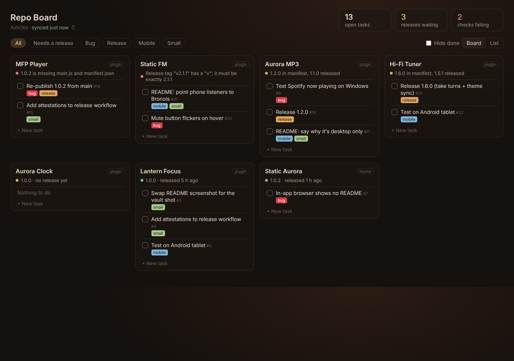
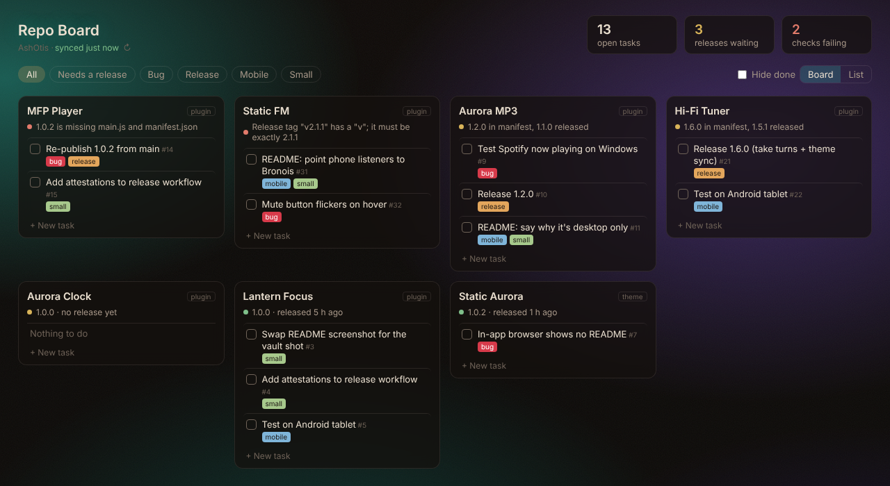

# Repo Board

A board of your GitHub repos in an Obsidian tab. Every repo gets a card with its open issues as tasks you can tick off, and a line telling you whether its latest release is ready for the Obsidian community directory.

Made for people who publish Obsidian plugins and themes, but it works for any public repos.

## What it shows

- **One card per repo** with its open issues. Click a title to open it on GitHub; tick the box to close it; tick again to reopen.
- **Release health**, worked out the way the directory checks it:
  - 🟢 released, and the release has the files the directory needs
  - 🟡 the version in `manifest.json` is newer than the last release, or there's no release yet
  - 🔴 the release is missing `main.js` / `theme.css` / `manifest.json`, or the tag doesn't match the version (for example `v1.0.2` instead of `1.0.2`)
- **Totals** for open tasks, releases waiting and checks failing.
- **Filters** by label (bug, release, mobile, small, idea and your own), a **Needs a release** filter, **Hide done**, and a **List** view.
- **+ New task** adds an issue to that repo, with labels.

Pinned repos (Settings → **Pin to the top**, handy for a to-do repo) always come first; after them, problem repos sort to the top. Forks, archived repos and pull requests are left out, and by default so are repos that aren't Obsidian plugins or themes.

## Setup

1. Settings → Repo Board → enter your GitHub user or organisation name.
2. Open the board from the ribbon or the command **Repo Board: Open the board**.
3. To tick tasks off and add new ones, add a token (below). Without one the board is read only.
4. Optional: turn on **Open when Obsidian starts** to make the board your home page, and choose a **Background**: None (your theme shows through), two built-in aurora pictures, any picture from your vault (with Darken and Blur), or **Static Aurora (live colours)**.

### Static Aurora (live colours)

Made for the [Static Aurora](https://github.com/AshOtis/aurora-theme) theme. The board shows the theme's drifting aurora glows, and its chips, tick boxes and highlights take on the same colours (the green, yellow and red release dots keep their meaning). When Static FM, Aurora MP3 or Hi-Fi Tuner recolour the theme, the board changes with it. Glow and Darken sliders set how strong it is. With another theme it uses Static Aurora's default colours.

### The token

Make a **fine-grained personal access token** on GitHub (Settings → Developer settings → Fine-grained tokens) with **Issues: Read and write** on the repos you want. Paste it into the plugin's settings.

The token is stored in this plugin's `data.json` inside your vault. Don't include it in a vault you share or publish.

A token also raises GitHub's limit from 60 to 5,000 requests an hour. Without one, refresh by hand or every hour.

## Privacy and network

Repo Board talks only to `api.github.com`, and only to read your repos, issues, releases and `manifest.json`, and to close, reopen or create issues when you ask it to. Nothing else is sent anywhere. Results are cached in the plugin's `data.json` so the board opens instantly.

## Support

If it saves you time, you can [buy me a coffee](https://buymeacoffee.com/ashotis). Bugs and ideas: [issues](https://github.com/AshOtis/repo-board/issues).

[GNU AGPL v3 or later](LICENSE) © AshOtis.
